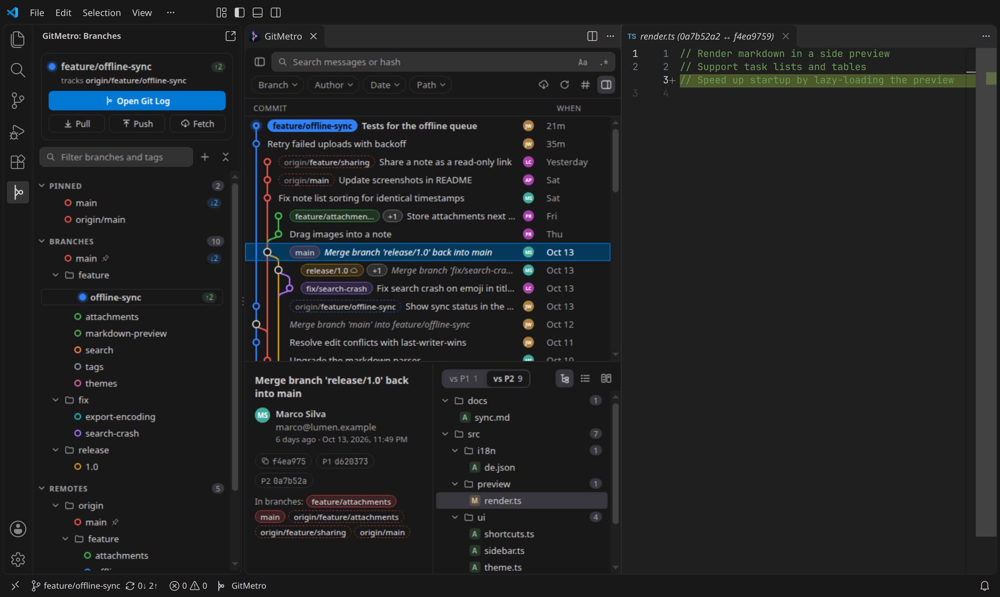
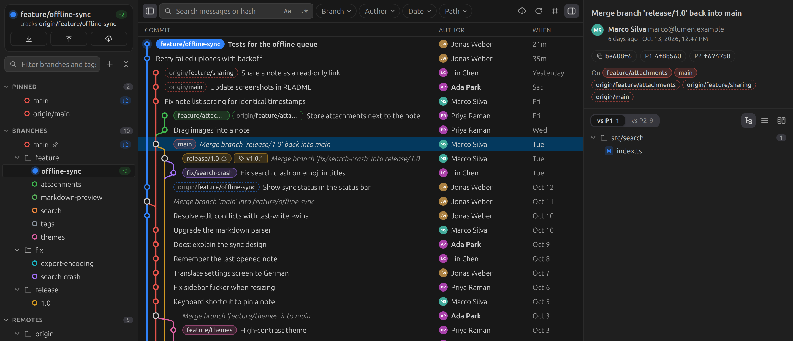
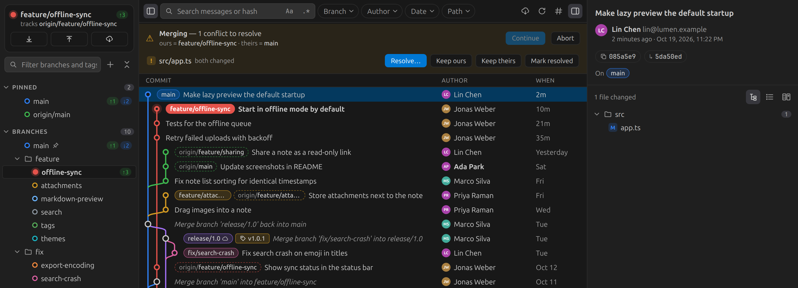
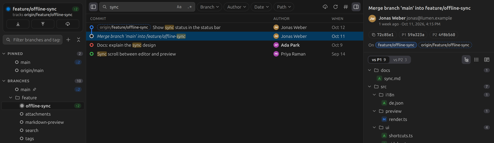
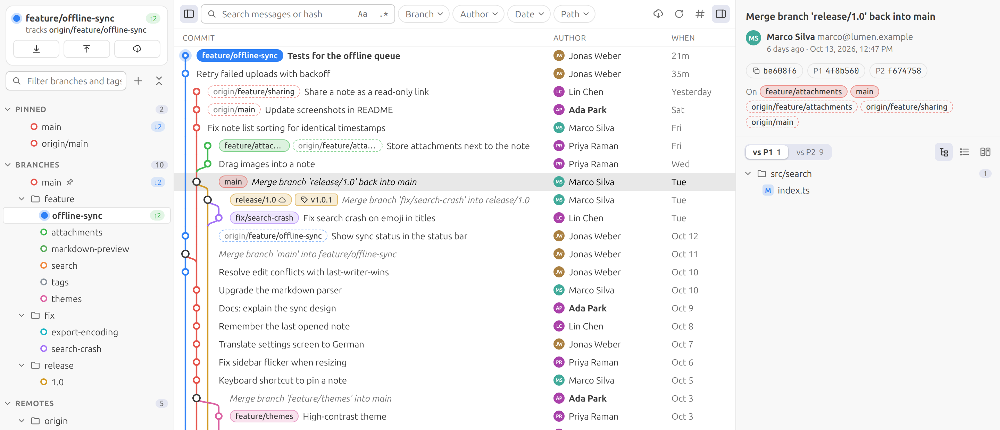

  

<h1 align="center">GitMetro</h1>

<b>Your repository as a metro map.</b> 
Commit graph, branches, merge diffs and conflict resolution in one Git panel for VS Code.

  <a href="https://marketplace.visualstudio.com/items?itemName=heyliam.gitmetro">VS Code Marketplace</a> ·
  <a href="https://open-vsx.org/extension/heyliam/gitmetro">Open VSX</a> ·
  <a href="https://github.com/heyliamme/gitmetro/blob/main/CHANGELOG.md">Changelog</a> ·
  <a href="https://github.com/heyliamme/gitmetro/blob/main/CONTRIBUTING.md">Contributing</a>

Every branch is a coloured line and every commit a station. Click any station to see
what changed. A branch keeps its colour everywhere: in the graph, in its label and in
the sidebar, so you can follow one line through a busy history.

Free and open source. No account and no telemetry. It runs the `git` already on your
machine.

## What it does

### A graph you can actually read

- Lines curve where branches fork and merge. A commit is a hollow station, a merge is
  an interchange, and HEAD glows.
- Old branches don't take up columns forever. An edge that runs a long way folds into a
  short dashed tail; click it to jump to the other end.
- Branch and tag labels sit on the commit in the line's colour. A local branch that
  matches its upstream shows as one label with a ☁ mark.
- History loads in pages as you scroll. Tested on a repository with 26,000 commits and
  11,000 merges.

### Merge commits, properly

Most tools show a merge commit as "no changes" or as one big combined diff. GitMetro
lets you switch between **vs P1** and **vs P2**: what the merge brought into your
branch, and what it changed relative to the branch that was merged in. Files that were
**edited during the merge** (different from every parent, usually a hand-resolved
conflict) are marked ✎.

### Conflicts without the guesswork

When a merge, rebase, cherry-pick, revert or stash pop stops on a conflict, a banner
lists every conflicted file:

- **Resolve…** opens VS Code's three-way merge editor.
- **Keep ours / Keep theirs** take one side. The banner shows real branch names, since
  during a rebase "ours" and "theirs" are the opposite of what most people expect.
- **Mark resolved** stages the file, and warns you if conflict markers are still in it.
- **Continue / Skip / Abort** the operation from the same place.

### Branches at a glance

- The **current branch card** shows its upstream, commits to push ↑ and to pull ↓, and
  Pull / Push / Fetch buttons.
- **Pinned**, **Branches**, **Remotes** and **Tags**, with `feature/…`-style folders
  and a filter box.
- Click a branch to jump to its tip. Double-click it to show only that branch.
- Right-click to switch, branch, merge, rebase, pull, push, rename, delete, or see
  *what's new since* your branch.

### Several repositories at once

In a multi-root workspace, the side bar lists every repository with its branch, ↑↓ and any
conflicts, like the Source Control view. Each repository gets its own log tab, so you can keep
two open side by side, each with its own filters.

### Blame, file history and line history

- **Toggle Blame Annotations** (editor or line-number context menu) puts author and date down
  the left of every line, shaded by age. Hover for the commit, click through to it in the log.
  It follows your edits, unsaved ones included.
- **Show File History** follows the file across renames.
- **Show History for Selection** lists the commits that touched the selected lines.

### Worktrees

A **Worktrees** section lists every worktree with its branch. Create one from a branch or a
commit, open it in a new window, lock, remove or prune it. Branches checked out in another
worktree say where.

### Search and filters

Search messages or jump to a hash, with match-case and regex toggles. Filter by
branch, author (including **Me**), date and path. Right-click a file anywhere and pick
**Show File History in GitMetro**.

### Everyday actions

Cherry-pick (merges included, optionally noting the source with `-x`, or just one file's
change from a commit), revert, reset (soft, mixed, hard or keep), interactive
rebase, amend the last message, uncommit, branch or tag from any commit, check out a
commit, diff any commit or branch against your working tree, export a patch, and open a
commit on GitHub, GitLab or Bitbucket.

Switching branches with uncommitted work? **Smart switch** stashes, switches and
re-applies the changes for you.

### Light or dark

GitMetro takes its colours from your VS Code theme. The graph's line colours come in two
palettes: **metro** (the default) and **atom**, Atom's One Dark colours, which switch to
One Light in light themes.

## Getting started

1. Install **GitMetro** from the Extensions view.
2. Open a folder that is a Git repository.
3. Click the **GitMetro** icon in the Activity Bar. Your branches open in the side bar
   and the log opens next to them as an editor tab, with the window to itself. Click a
   branch to jump to it in the log; double-click to show only that branch.

You can also open it from **GitMetro** in the status bar, or from the **GitMetro** tab in
the bottom panel (give the panel some height, or use ↗ in its title bar to move it to an
editor tab). Commands: **GitMetro: Open Git Log
in Editor** and **GitMetro: Open Git Log**. To bind a key, assign one to
`gitmetro.openEditor` in Keyboard Shortcuts.

## Keyboard

| In the log | |
| --- | --- |
| `↑` `↓` `PgUp` `PgDn` `Home` `End` | Move; hold `Shift` to select a range |
| `Ctrl`/`Cmd`+click | Add a commit to the selection (several commits show a combined diff) |
| `→` / `←` | Go to parent / child |
| `Enter` | Move to the changed files |
| `Ctrl`/`Cmd`+`C` | Copy hash |
| `Ctrl`/`Cmd`+`F` | Search |

In the file list, `↑`/`↓` preview each diff and `Enter` opens it.

## Settings

| Setting | Default | |
| --- | --- | --- |
| `gitmetro.pageSize` | `3000` | Commits loaded per page |
| `gitmetro.order` | `date` | `date` interleaves branches by time; `topo` keeps each branch together |
| `gitmetro.gitPath` | `git` | Path to the git executable |
| `gitmetro.palette` | `metro` | Line colours: `metro` (saturated) or `atom` (One Dark, One Light in light themes) |
| `gitmetro.statusBar` | `true` | Show the GitMetro button in the status bar |
| `gitmetro.openLogFromSidebar` | `true` | Open the log tab when the Activity Bar view is shown |

## Requirements

- VS Code 1.90 or newer, or a compatible editor that installs from Open VSX
- Git 2.24 or newer on your `PATH`

## Privacy and security

GitMetro runs local `git` commands and nothing else. It makes no network requests of
its own; Fetch, Pull and Push are git doing what you asked. It stays off in
[Restricted Mode](https://code.visualstudio.com/docs/editor/workspace-trust), because
running git in a repository you don't trust can run that repository's hooks.

Found a vulnerability? See [SECURITY.md](SECURITY.md).

## Contributing

Bug reports, ideas and pull requests are welcome. [CONTRIBUTING.md](CONTRIBUTING.md)
explains how to run the extension from source, and how to preview the UI in a browser
against a generated demo repository.

## License

[MIT](LICENSE)
